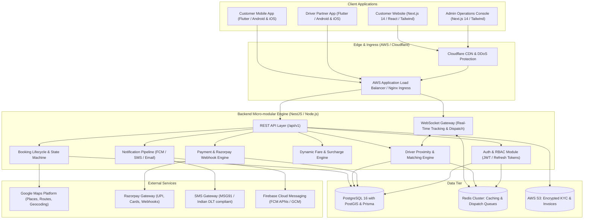

# DRIVERYO System Architecture Document

## 1. Executive Summary
**DRIVERYO** is a premium, on-demand professional driver booking platform engineered specifically for **customer-owned vehicles**. Unlike traditional taxi or cab aggregators (e.g., Uber, Ola), Driveryo provides vetted, professional chauffeurs who arrive at the customer's location to drive the customer's private car.

Initial Launch Location: **Hyderabad, Telangana, India** (expanding across Tier-1/2 Indian metros).

---

## 2. High-Level System Architecture Diagram

---

## 3. Technology Stack Breakdown

| Layer | Technology | Rationale |
| :--- | :--- | :--- |
| **Customer Website** | Next.js 14, React 18, TypeScript, Tailwind CSS | Fast SSR/SSG for SEO, seamless dynamic booking widget, mobile-responsive. |
| **Admin Operations** | Next.js 14, React 18, TypeScript, Tailwind CSS | High productivity, reusable dashboard widgets, real-time live map operations. |
| **Customer Mobile App** | Flutter 3.x, Dart | Single codebase for iOS and Android, native 60fps animations, reactive state. |
| **Driver Mobile App** | Flutter 3.x, Dart | Reliable background location tracking, battery-efficient telemetry, push dispatch. |
| **Backend Core** | NestJS, TypeScript, Node.js | Clean architecture, modular dependency injection, enterprise TypeScript, WebSockets. |
| **Database & ORM** | PostgreSQL 16 + Prisma ORM | ACID compliance, geospatial indexing, relational integrity, migrations. |
| **Cache & Queue** | Redis 7 | In-memory driver spatial index, active dispatch queues, token blacklists, session caching. |
| **Payments** | Razorpay (UPI, Credit/Debit, Netbanking) | Standard of excellence in India; comprehensive webhooks and automated refunds. |
| **Maps & Routing** | Google Maps Platform | Accurate Indian road topology, Places autocomplete, distance matrix. |
| **Push & SMS** | Firebase Cloud Messaging (FCM) & MSG91 | High-throughput Indian DLT SMS delivery and instant background push notifications. |

---

## 4. Key Subsystem Workflows

### 4.1 Driver Matching & Dispatch Algorithm
1. **Request Intake**: Customer triggers booking with pickup coordinate $L_{pickup} = (\phi_p, \lambda_p)$, vehicle type (e.g. Sedan, Automatic), service type (e.g. Instant).
2. **Radial Search**: System queries Redis GEO index (`GEORADIUS` / `GEOSEARCH`) for verified, active drivers with `isOnline: true`, `isBusy: false`, and matching transmission skill ($R = 5\text{ km}$, expandable to $10\text{ km}$).
3. **Offer Batching**: Offer sent to nearest optimal driver via WebSocket/FCM with a **30-second accept timeout**.
4. **Locking & Concurrency**: Atomic claim handled via Redis lock. If driver rejects or times out, the next ranked driver is queried.
5. **Assignment Confirmation**: Driver accept triggers booking status update to `ASSIGNED`, locks driver state to `isBusy = true`, sends push notification and live tracking link to customer.

### 4.2 Security & Financial Integrity
- **Two-Sided Trip Start OTP**: Driver cannot start the trip meter without inputting the customer's unique 4-digit OTP.
- **Server-Side Pricing Verification**: All quotes are cryptographically signed or generated server-side from official `PricingRule` entities.
- **Razorpay Webhook Verification**: Signature verification (`HMAC SHA256`) is mandatory before booking transition to `PAID`.
