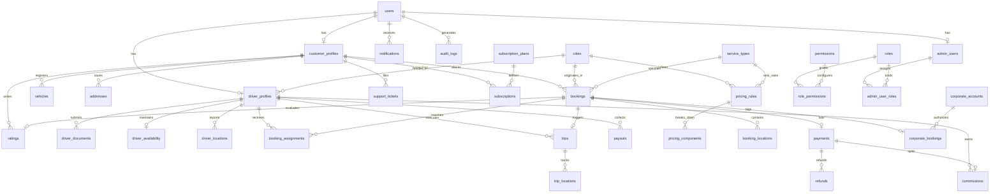

# DRIVERYO Database Schema & Entity Relationship Documentation

## 1. Overview
The database layer for Driveryo is designed using **PostgreSQL 16** with **Prisma ORM**. It enforces full referential integrity, strict foreign key constraints, atomic status transitions, and geospatial indexing for real-time driver proximity matching in Hyderabad and future Indian expansion cities.

---

## 2. Entity Relationship Diagram (ERD)

---

## 3. Core Relational Models

### 3.1 Users (`users`)
- Master user entity handling phone authentication, passwords (for admin/corporate), roles (`CUSTOMER`, `DRIVER`, `ADMIN`, `SUPER_ADMIN`), and account statuses (`ACTIVE`, `SUSPENDED`, `BLOCKED`).
- Uses unique phone numbers with Indian national standard formatting (`+91XXXXXXXXXX`).

### 3.2 Drivers & Documents (`driver_profiles`, `driver_documents`, `driver_availability`)
- Driver KYC compliance: Driving license (front/back), Aadhaar card, PAN card, Police verification certificate, Bank passbook.
- `approvalStatus`: Strict state machine (`PENDING` -> `UNDER_REVIEW` -> `APPROVED` | `REJECTED`). Unapproved drivers cannot go online or receive booking dispatch offers.
- `driver_availability`: Real-time latch for `isOnline`, `isBusy`, GPS coordinates (`currentLatitude`, `currentLongitude`), and heartbeat `lastPingAt`.

### 3.3 Bookings & Assignments (`bookings`, `booking_locations`, `booking_assignments`)
- Tracks booking number (e.g. `DRV-202611-8942`), customer, vehicle attributes (Make, Model, Transmission, Category), pickup, destination, scheduled start time, OTP code, status flow.
- `booking_assignments`: Offers dispatched to candidate drivers with timestamps and status (`OFFERED`, `ACCEPTED`, `REJECTED`, `TIMED_OUT`).

### 3.4 Trips & Telemetry (`trips`, `trip_locations`)
- Active trip state: `NOT_STARTED` -> `IN_PROGRESS` -> `COMPLETED`.
- Guarded by 4-digit Customer Trip OTP.
- High-frequency GPS breadcrumbs (`trip_locations`) recording timestamp, speed, latitude, and longitude for real-time customer tracking and dispute audit trails.

### 3.5 Pricing & Settlements (`pricing_rules`, `payments`, `commissions`, `payouts`)
- Flexible city-level and service-level rules: Base fare, included hours, extra hourly rate, waiting charge per minute, night surcharge window (e.g., 22:00 to 06:00), cancellation fees, GST 18%.
- Automatic platform commission split (e.g., 80% to driver partner, 20% Driveryo commission).
- Payout ledger tracking batched driver bank transfers via NEFT/IMPS/RazorpayX.
