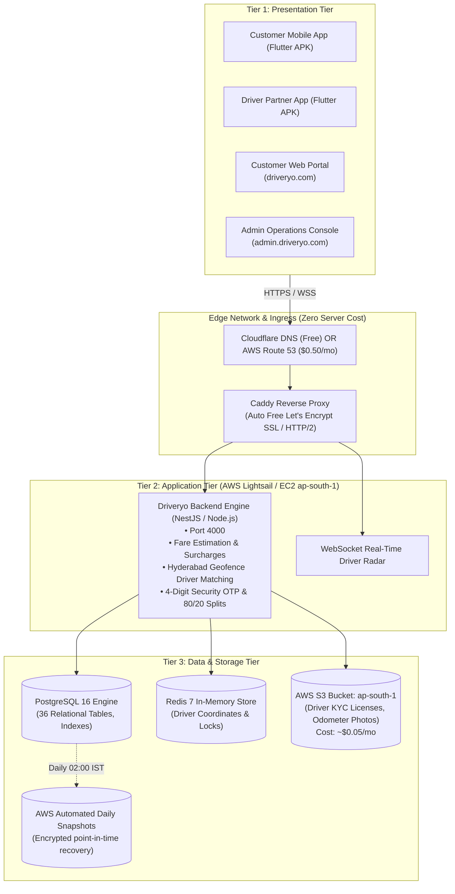

# DRIVERYO — AWS Low-Cost Cloud Deployment Plan
## Budget Target: ₹400 – ₹1,200 / month ($5 – $15 / month) | Hyderabad Launch Region: `ap-south-1` (Mumbai)

---

## 1. Executive Summary & Budget Comparison

Deploying on Amazon Web Services (AWS) often frightens startups because enterprise templates (Multi-AZ RDS + ALB + NAT Gateways + ECS) quickly reach **$150 – $300/month (₹12,000 – ₹25,000/mo)** before launching.

This plan uses a **Lean 3-Tier Architecture** that eliminates all unnecessary AWS enterprise overhead while maintaining high performance, automated backups, and low latency for customers and drivers in Hyderabad.

| Tier / Approach | Monthly Cost (USD) | Monthly Cost (INR) | Capacity & Traffic | Recommended For |
| :--- | :--- | :--- | :--- | :--- |
| **Plan 0: AWS 12-Month Free Tier** | **$0.00** | **₹0 / month** | 1,000 rides / month | Development & initial MVP launch |
| **Plan A: AWS Lightsail Lean Stack (Recommended)** | **$5.00 – $10.00** | **₹420 – ₹840 / month** | 5,000 – 15,000 rides / month | Hyderabad commercial rollout & pilot |
| **Plan B: EC2 Graviton (t4g.small) + S3 + RDS** | **$15.00 – $22.00** | **₹1,250 – ₹1,850 / month** | 25,000+ rides / month | Scaled fleet across Hyderabad |

---

## 2. The 3-Tier AWS Lean Architecture



---

## 3. Plan A: The $5 – $10/mo Lightsail Stack (Best Value)

### Why AWS Lightsail is Best for Limited Budgets:
Standard AWS EC2 charges separately for compute, public IPv4 addresses ($3.65/mo), data egress ($0.09/GB), disk volume IOPS, and network interfaces.  
**AWS Lightsail bundles everything into one predictable fixed bill with zero surprise charges:**

### Bill of Materials (Monthly Cost Breakdown in INR):

| Component | AWS Resource | Monthly Cost ($) | Monthly Cost (₹) | What It Includes |
| :--- | :--- | :--- | :--- | :--- |
| **Server & Compute** | Lightsail 2GB RAM / 2 vCPU / 60GB SSD | $10.00 | ₹840 | Linux VPS, 3 TB fast data transfer, fixed Public IPv4, firewall |
| **Object Storage** | AWS S3 Standard (`ap-south-1`) | $0.20 | ₹17 | 10 GB driver KYC photos, RC copies, inspection images |
| **DNS & SSL** | Cloudflare Free DNS + Caddy | $0.00 | ₹0 | Free SSL certificates, DDoS protection, edge caching |
| **Database Backups** | Lightsail Automated Daily Snapshots | $0.50 | ₹42 | Automated 7-day retention point-in-time recovery |
| **TOTAL** | — | **$10.70 / mo** | **~₹899 / month** | Complete 3-tier production system |

*(Note: If choosing the $5.00 / month Lightsail instance (1GB RAM + 40GB SSD), the total bill is **~₹480 / month**).*

---

## 4. How We Eliminate the 5 Classic AWS "Cost Traps"

| Dangerous AWS Resource | Standard Cost | Why Avoid It | Our Lean Solution | You Save |
| :--- | :--- | :--- | :--- | :--- |
| **AWS NAT Gateway** | $32.85 / month | Used to give private subnets internet access | Place instance in public subnet with strict Security Group firewall | **Save ₹2,750 / mo** |
| **Application Load Balancer (ALB)** | $18.50 – $25.00 / mo | Load balancing for a single instance is unnecessary | Use lightweight **Caddy** container for SSL and reverse proxy | **Save ₹1,650 / mo** |
| **Multi-AZ RDS PostgreSQL** | $30.00 – $60.00 / mo | 2x cost for standby replica | Run PostgreSQL container with automated S3 snapshots & volume backups | **Save ₹2,500 – ₹5,000 / mo** |
| **AWS ElastiCache Redis** | $13.50 / mo (cache.t4g.micro) | Overkill for initial launch | Run Redis 7 Alpine in Docker on the same high-speed internal bridge | **Save ₹1,130 / mo** |
| **Data Egress Overcharges** | $0.09 per GB transferred | Can skyrocket if images are transferred | Lightsail includes **3,000 GB (3 TB)** free transfer every month | **Save ₹1,000+ / mo** |

**Total Monthly Savings: ₹9,000 – ₹12,000 / month ($110 – $145 / month)!**

---

## 5. Step-by-Step Deployment Guide (30-Minute Launch)

### Step 1: Create Your AWS Lightsail Instance in Mumbai
1. Log into your [AWS Management Console](https://console.aws.amazon.com).
2. Set region to **Asia Pacific (Mumbai) `ap-south-1`** (critical for 15ms latency in Hyderabad).
3. Search for **Lightsail** -> Click **Create instance**.
4. Platform: **Linux/Unix** -> Blueprint: **OS Only -> Ubuntu 22.04 LTS**.
5. Instance Plan: Choose **$10/month** (2 GB RAM, 2 vCPUs, 60 GB NVMe SSD, 3 TB transfer).
6. Name instance: `driveryo-production-hyd`.
7. Click **Create instance**.

### Step 2: Attach a Static IP & Open Ports
1. In Lightsail, go to the **Networking** tab -> Click **Create static IP** -> Attach to `driveryo-production-hyd`.
2. Under **IPv4 Firewall**, ensure these ports are open:
   - Port `22` (SSH - restricted to your IP if preferred)
   - Port `80` (HTTP)
   - Port `443` (HTTPS - Web, Admin, Mobile API, WebSockets)

### Step 3: Run the 1-Click Automated Setup Script
Connect to your instance via the browser SSH console or terminal, then run:

```bash
# Clone the Driveryo repository
git clone https://github.com/<your-org>/driveryo.git /opt/driveryo
cd /opt/driveryo

# Run our automated setup script
chmod +x infrastructure/deployment/aws/setup-ec2-lightsail.sh
sudo ./infrastructure/deployment/aws/setup-ec2-lightsail.sh
```

This automated script performs:
- Installs Docker Engine & Docker Compose v2.
- Configures 2 GB swap space for RAM stability.
- Launches PostgreSQL 16, Redis 7, Driveryo Backend, Next.js Web, Admin, and Caddy.
- Obtains automatic free SSL certificates for your domain (`driveryo.com`, `api.driveryo.com`, `admin.driveryo.com`).
- Schedules a daily cron job at 02:00 AM IST to dump PostgreSQL and upload encrypted backups to AWS S3.

### Step 4: Configure Your Domain DNS (Cloudflare or Route 53)
Create these DNS `A` records pointing to your Lightsail Static IP:
- `driveryo.com` -> `<Lightsail-Static-IP>` (Customer Website)
- `admin.driveryo.com` -> `<Lightsail-Static-IP>` (Admin Operations Console)
- `api.driveryo.com` -> `<Lightsail-Static-IP>` (Backend REST API & WebSockets)

---

## 6. AWS Billing Alert & Zero-Overrun Protection

To guarantee AWS never charges more than your desired budget, set up AWS Budgets:

1. In AWS Console, search for **AWS Budgets** -> Click **Create budget**.
2. Select **Cost budget** -> Set budget amount: **$12.00 USD / month**.
3. Set alert thresholds:
   - **Alert 1 (Warning)**: When actual spend exceeds **$8.00 (66%)**, send an instant email.
   - **Alert 2 (Critical)**: When forecasted spend exceeds **$11.00 (90%)**, send an urgent SMS and email.
4. Save budget. You are now 100% protected against unexpected cloud billing surprises.

---

## 7. Connecting Your Mobile Apps

In both `apps/customer-mobile` and `apps/driver-mobile`:
Update the `baseUrl` in their respective API services to your new secure AWS domain:

```dart
// Production AWS Mumbai Endpoint
static const String baseUrl = 'https://api.driveryo.com/api/v1';
```

Build the release APKs:
```powershell
.\scripts\build-mobile-apps.ps1 -Target all -Mode release
```
Your Driveryo Customer and Driver Android APKs are now connected to your own high-performance, cost-optimized AWS infrastructure in Mumbai!
