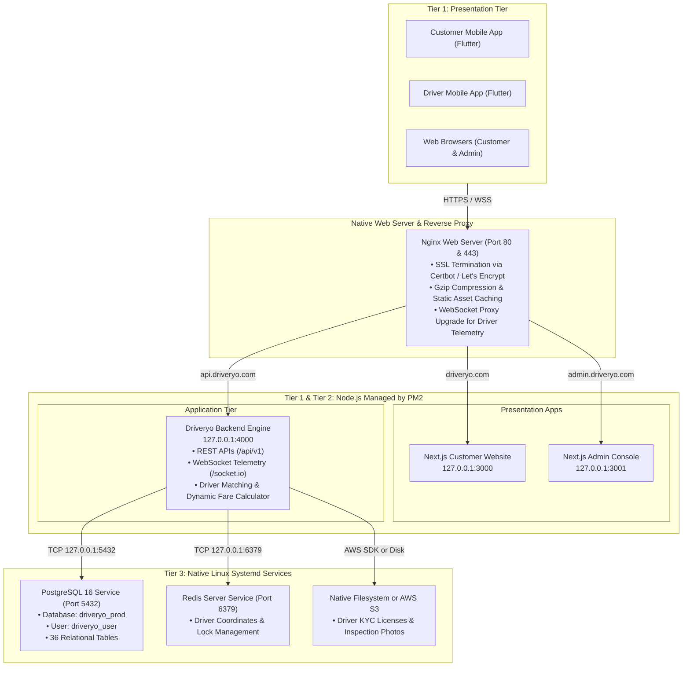

# DRIVERYO — Native Server Deployment Guide (No Docker)
## 3-Tier Architecture on Bare-Metal Ubuntu / Linux VPS (PM2 + Nginx + PostgreSQL + Redis)

This guide shows how to deploy DRIVERYO onto a **normal standard Linux server (without Docker)**.

---

## 1. Why "No Docker" is Great for Budget Servers

| Metric | Docker Stack | Native Bare-Metal (No Docker) |
| :--- | :--- | :--- |
| **Idle RAM Overhead** | ~800 MB – 1.2 GB | **~350 MB – 500 MB (Uses 50% less RAM!)** |
| **Works on $3.50/mo VPS (512MB RAM)** | ⚠️ Unstable / Out of Memory | **✅ Smooth with 2GB swap** |
| **Disk I/O Performance** | Container overlay filesystem | **Direct native NVMe disk performance** |
| **Process Inspection** | `docker logs`, `docker exec` | Standard `pm2 logs`, `systemctl status`, `htop` |
| **Complexity** | Images, volumes, compose bridges | Standard Linux packages (`apt`), files on disk |

---

## 2. Native 3-Tier Architecture Map



---

## 3. Step-by-Step Installation on Ubuntu (No Docker)

### Step 1: Provision Any Standard Ubuntu 22.04 LTS Server
- AWS Lightsail ($3.50 or $5/month in Mumbai `ap-south-1`)
- AWS EC2 `t4g.nano` or `t4g.micro`
- DigitalOcean Droplet ($4/mo), Linode, Hetzner, or any regular Linux VPS.

### Step 2: Clone Repository & Run the 1-Click Provisioner
Connect via SSH to your server and run:

```bash
# Clone the repository
git clone https://github.com/<your-username>/driveryo.git /opt/driveryo
cd /opt/driveryo

# Run our native bare-metal setup script
chmod +x infrastructure/deployment/bare-metal/setup-bare-metal.sh
sudo ./infrastructure/deployment/bare-metal/setup-bare-metal.sh
```

### What this script configures automatically:
1. **Swap Memory**: Creates 2GB swap space to ensure zero crashes on small 512MB/1GB VPS instances.
2. **Node.js 20 LTS**: Installs Node.js and PM2 globally.
3. **PostgreSQL 16**: Installs PostgreSQL, creates database `driveryo_prod`, creates user `driveryo_user`, and sets permissions.
4. **Redis 7**: Installs and starts native Redis via systemd.
5. **Nginx Reverse Proxy**: Configures `driveryo.com`, `admin.driveryo.com`, and `api.driveryo.com` with WebSocket support.
6. **Builds Apps**: Installs dependencies and builds the Backend, Website, and Admin.
7. **PM2 Process Manager**: Starts all 3 apps, enables auto-restart on crashes, and enables automatic reboot startup.
8. **UFW Firewall**: Hardens the server, only allowing ports 22, 80, and 443.

---

## 4. Setup Free HTTPS / SSL in 30 Seconds

Once your domain DNS records (`driveryo.com`, `admin.driveryo.com`, `api.driveryo.com`) point to your server's IP address, run Certbot:

```bash
sudo certbot --nginx -d driveryo.com -d www.driveryo.com -d admin.driveryo.com -d api.driveryo.com
```

Certbot will automatically edit your Nginx configuration, issue free Let's Encrypt SSL certificates, and schedule auto-renewal.

---

## 5. Daily Operations & Useful Commands

### Manage Applications with PM2:
```bash
# Check status of all applications (CPU, RAM, uptime)
pm2 status

# Real-time live dashboard
pm2 monit

# View live backend logs
pm2 logs driveryo-backend

# Restart an application
pm2 restart driveryo-backend
pm2 restart all

# Reload with zero-downtime
pm2 reload all
```

### Manage Database (PostgreSQL):
```bash
# Connect to PostgreSQL CLI
sudo -u postgres psql -d driveryo_prod

# Check active database tables
\dt

# Run manual database backup
pg_dump -U driveryo_user -h 127.0.0.1 -d driveryo_prod | gzip > /opt/driveryo_backup_$(date +%F).sql.gz
```

### Manage Web Server (Nginx):
```bash
# Test Nginx configuration for errors
sudo nginx -t

# Reload Nginx without disconnecting users
sudo systemctl reload nginx

# View Nginx access & error logs
sudo tail -f /var/log/nginx/error.log
sudo tail -f /var/log/nginx/access.log
```

---

## 6. Connecting Your Flutter Mobile Apps

Open [`apps/customer-mobile/lib/services/api_service.dart`](file:///C:/Users/Rafi/.gemini/antigravity/scratch/driveryo/apps/customer-mobile/lib/services/api_service.dart) and [`apps/driver-mobile/lib/services/driver_api_service.dart`](file:///C:/Users/Rafi/.gemini/antigravity/scratch/driveryo/apps/driver-mobile/lib/services/driver_api_service.dart):

```dart
// Native server domain
static const String baseUrl = 'https://api.driveryo.com/api/v1';
```

Then build your release APKs:
```powershell
.\scripts\build-mobile-apps.ps1 -Target all -Mode release
```
Your compiled Customer and Driver mobile APKs will communicate directly with your native Linux server!
